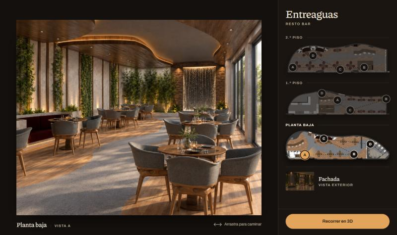
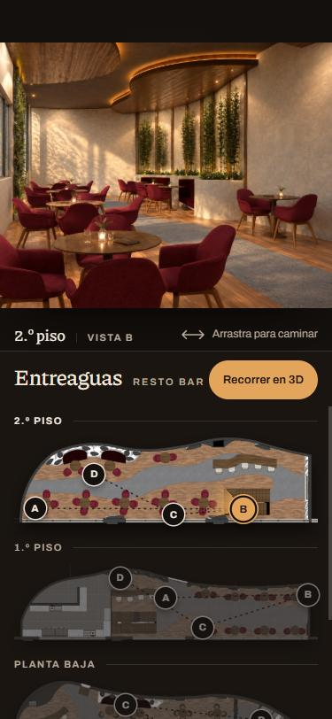
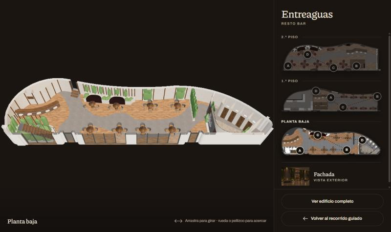

# Entreaguas Resto Bar

Un recorrido web por los interiores de **Entreaguas Resto Bar**. La página muestra los renders originales del proyecto tal como fueron entregados, se navega desde los planos de planta y permite caminar de una vista a otra arrastrando la imagen. Si se quiere ir más allá, el modelo 3D completo se puede recorrer libremente desde cualquier ángulo.



## Qué se puede hacer

- **Ir directo a cualquier lugar desde el plano.** Los tres pisos están apilados como en el edificio. Cada vista es un marcador sobre su planta, con un haz que indica hacia dónde mira la cámara. Al pasar el mouse aparece una miniatura.
- **Caminar arrastrando la imagen.** Entre dos vistas seguidas de un mismo piso hay un tramo de video: arrastrar a la izquierda avanza y a la derecha vuelve. Mientras tanto, un punto avanza sobre el plano. Las flechas del teclado también pasan de vista.
- **Rodear la fachada.** En la vista exterior, arrastrar la imagen mueve la cámara alrededor del frente.
- **Recorrer el modelo 3D.** "Recorrer en 3D" carga el modelo del arquitecto y sigue en la misma vista. Tocar un plano corta el edificio en ese piso para verlo desde arriba, y "Ver modelo" compara cada render con la geometría real. "Volver al recorrido guiado" regresa a los renders sin perder lo cargado.

<table>
  <tr>
    <td width="34%"></td>
    <td></td>
  </tr>
  <tr>
    <td align="center"><sub>En el celular, el mapa pasa abajo</sub></td>
    <td align="center"><sub>Modelo 3D con la planta baja cortada</sub></td>
  </tr>
</table>

## Cómo está hecho

- **Liviana primero.** La página abre con la fachada, su clip y los planos: unos 2,5 MB. Three.js y el modelo (8,6 MB) se descargan recién al pedir el 3D, y cada tramo de video se baja cuando hace falta.
- **El modelo real, optimizado.** El GLB exportado desde SketchUp pasó de 52 MB y 5,7 millones de triángulos a 8,6 MB y 1,4 millones: materiales convertidos a PBR, mobiliario repetido instanciado, simplificación solo en piezas densas, texturas en WebP y compresión Meshopt.
- **Vistas exactas.** Cada render está asociado a la escena de SketchUp desde la que se hizo, con el campo de visión ajustado a mano para que el modelo calce debajo.
- **Planos calibrados.** Las plantas salen de los PDF de LayOut y están ubicadas sobre el modelo superponiéndolas a una vista cenital: los marcadores caen donde está la cámara de cada render.
- **Tramos de video.** Los nueve tramos interiores y el giro de la fachada se generaron con Seedance (vía Higgsfield) a partir de pares de renders consecutivos. Cada clip empieza y termina en un render original, así que el paso entre imagen y video no se nota.

Está escrita en JavaScript sin framework, con [Vite](https://vite.dev) y [Three.js](https://threejs.org).

## Correrla en tu computadora

Necesita Node 22.

```bash
npm install
npm run dev        # abre la página en http://localhost:5173
npm test           # pruebas
npm run build      # genera el sitio listo para publicar en web/dist
```

## Publicarla en Vercel

1. Entrar a [vercel.com/new](https://vercel.com/new) e importar este repositorio de GitHub.
2. Tocar **Deploy**. No hace falta configurar nada: `vercel.json` ya indica cómo compilar y qué carpeta publicar.

Después, cada cambio que se sube a `main` se publica solo.

## Estructura

```
web/                  la página
  index.html
  src/                código: main.js arranca todo; map.js, walk.js, gallery.js y app3d.js
  public/
    renders/          los 13 renders originales y sus miniaturas
    planos/           plantas recortadas de los PDF
    recorrido/        los 9 tramos de video entre vistas
    exterior/         el clip para rodear la fachada
    model/            el modelo 3D optimizado
    views.json        cámara de cada render (posición, orientación, campo de visión)
    floors.json       altura y huella de cada piso
tools/                scripts que generan lo que está en public/
tests/                pruebas con Vitest
higgsfield/           los clips tal como salieron de Higgsfield
docs/                 especificación, plan de trabajo y capturas
```

## Regenerar los recursos

Los archivos originales del proyecto (el `.skp` de SketchUp, los PDF de las plantas y el GLB sin optimizar) no están en el repositorio a propósito. Para volver a generar lo que está en `web/public/`, hay que ponerlos en la raíz del proyecto y correr:

| Comando | Qué hace | Necesita |
|---|---|---|
| `npm run optimize` | Optimiza el modelo 3D | `santiago mercado.glb` |
| `npm run check` | Verifica peso, triángulos y materiales del modelo | el modelo optimizado |
| `npm run views` | Extrae la cámara de cada render | un GLB con las escenas |
| `node tools/measure-floors.mjs --write` | Mide la altura y la huella de cada piso | `santiago mercado.glb` |
| `npm run plans` | Extrae y recorta las plantas | `PB.pdf`, `PA.pdf`, `PA1.pdf` |

## Créditos

- Renders, planos y modelo 3D: proyecto de diseño interior de Entreaguas Resto Bar.
- Tramos de video: generados con Seedance a partir de los renders.
- Tipografías: Piazzolla, de Huerta Tipográfica, y Archivo, de Omnibus-Type, ambas con licencia SIL Open Font License.
